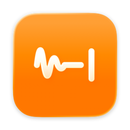

<p align="center">
  
</p>

<h1 align="center">Macpr Flow</h1>

<p align="center">
  Hold a key, speak, let go. Clean text appears wherever your cursor is.<br>
  Private, on-device dictation for macOS, built only on Apple's frameworks.
</p>

---

Macpr Flow is a menu-bar dictation app for Apple silicon Macs. It transcribes with Apple's on-device `SpeechTranscriber`, tidies the text instantly, and, when it helps, polishes it with the on-device Apple Intelligence model. Then it pastes the result into whatever app you're using. There are no accounts, API keys, servers or third-party dependencies, and nothing you say leaves your Mac.

## Features

- **Hold to talk, tap for hands-free.** Hold the shortcut, speak, release to insert. Tap it once to keep listening, then tap again or press the stop button. Esc cancels.
- **Works in every app.** It pastes at the cursor in native apps, browsers, Electron apps and terminals, then puts your clipboard back.
- **Fast.** The speech model stays loaded, the next session is prepared while you're idle, and the shortcut runs on its own thread, so pressing it only starts the microphone.
- **Understands corrections.** "Meet at 3, sorry, 4 pm" becomes "Meet at 4 pm". It also handles "I mean", "no wait", "not John, Mike" and "scratch that". Real apologies such as "Sorry I'm late" stay.
- **Instant cleanup.** Fillers (um, uh), stutters ("the the") and spoken "new paragraph" are handled in microseconds. Apple Intelligence is used only when a dictation needs judgement: lists, spoken punctuation, long text. Its output is checked against what you actually said and rejected if it answers, summarises or invents anything.
- **Personal dictionary.** Add names and jargon. With *Learn from your corrections* on, fixing a misheard word right after dictating adds it automatically.
- **Snippets.** Say a trigger phrase on its own ("my calendar link") to insert saved text.
- **A listening orb that reacts to your voice.** It's drawn in Metal at your display's refresh rate and reads the microphone roughly every 10 ms, with adjustable sensitivity. There are two styles:

  | Ember | Orbit |
  | --- | --- |
  |  |  |

  Each strip shows quiet, speaking, loud and writing.
- **Microphone choice.** *Automatic* follows your Mac's input but switches to the built-in mic when Bluetooth headphones connect, so their audio stays at full quality.
- **Liquid Glass app icon** that follows your Default, Dark, Clear or Tinted icon style.
- **Native settings** (General, Dictionary, Snippets, History) with real usage stats: words dictated, speaking speed and time saved.

## Requirements

- An Apple silicon Mac running **macOS 26 or later**
- **Xcode 26** or later (Swift 6.2+) to build
- Apple Intelligence turned on, for the optional polish step. Without it, everything else still works.

## Install

**Download the app:** grab `MacprFlow-<version>.dmg` from the [latest release](https://github.com/tanmaybawakar/macpr-flow/releases/latest), open it, and drag **Macpr Flow** into **Applications**.

The app isn't notarized yet, so the first time you open it macOS will block it. Either right-click the app → **Open** → **Open**, or go to **System Settings → Privacy & Security** and click **Open Anyway**. If macOS says the app is damaged, run:

```sh
xattr -dr com.apple.quarantine "/Applications/Macpr Flow.app"
```

### Build from source

```sh
git clone https://github.com/tanmaybawakar/macpr-flow.git
cd macpr-flow
Scripts/package_app.sh      # build, sign and install to /Applications
Scripts/make_dmg.sh         # or build a .dmg in .build/
```

Without a signing identity the app is ad-hoc signed, and macOS asks for Microphone and Accessibility again after each rebuild. To keep those permissions, sign with your own identity:

```sh
security find-identity -v -p codesigning
echo 'APP_IDENTITY=<your identity hash>' > Scripts/signing.local   # git-ignored
```

## First run

1. Open **Macpr Flow** from Applications. Its settings window opens and lists what's still needed.
2. Allow the **Microphone**, then enable Macpr Flow under **System Settings → Privacy & Security → Accessibility**. Accessibility is needed to notice the global shortcut and paste into other apps. The app checks again by itself, so there's no need to restart it.
3. The English speech model downloads from Apple the first time, if it isn't already on your Mac.
4. Put the cursor in any text field, hold **⌃⌘** (or the shortcut you chose), speak and release.

To use **fn (Globe)** as the shortcut, set *System Settings → Keyboard → Press Globe key to* → **Do Nothing**, so macOS doesn't open the emoji picker as well. Settings links you there.

## Privacy

- Speech recognition and polishing run **on your Mac**. There is no cloud fallback and no telemetry.
- No audio is ever written to disk.
- Dictation history is kept in memory and cleared when you quit, unless you turn on *Keep history after quitting*. In that case it's saved only to `~/Library/Application Support/Macpr Flow/history.json`.
- The pasted text is marked transient so clipboard managers skip it, and your previous clipboard is restored afterwards.
- Password fields and secure input are never typed into. The text is copied instead, so you choose where it goes.

## Troubleshooting

| Problem | Fix |
| --- | --- |
| The shortcut does nothing | Check that Macpr Flow is enabled under Accessibility. If you rebuilt with a different signature, turn it off and on again. |
| "No speech heard" | Settings → General → Microphone shows which mic is recording. Pick the right one or choose *System default*. |
| The orb flashes but nothing records with fn | Set *Press Globe key to* → **Do Nothing** in Keyboard settings. |
| Polish never runs | Apple Intelligence must be enabled and finished downloading. Settings shows its status. |
| Text lands in the wrong place | Macpr Flow pastes into whichever app is frontmost when you finish. Keep that window focused until the text appears. |

Developer checks, run from Terminal:

```sh
APP="/Applications/Macpr Flow.app/Contents/MacOS/MacprFlow"
"$APP" --model-check                       # Apple Intelligence cleanup cases
"$APP" --microphone-check                  # start/finish latency, cold and warm (records 3 × 2 s)
"$APP" --transcribe-file path/to/audio.aiff
"$APP" --render-orbs ./out                 # renders both orb styles to PNG
```

## How it works

See [docs/ARCHITECTURE.md](docs/ARCHITECTURE.md) for the full design: the event-tap thread, the warm speech pipeline, the cleanup stages and their safety checks, insertion, learning, and the Metal orb.

## Contributing

Bug reports and pull requests are welcome. Read [CONTRIBUTING.md](CONTRIBUTING.md) first. In short: run `swift test`, keep it dependency-free, and keep everything on device.

## License

[MIT](LICENSE)
